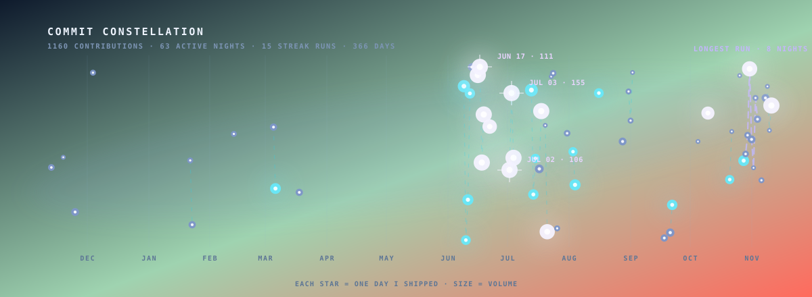

# Olá, sou a Maria 👋

### Full Stack Engineer · Sistemas resilientes · Open source · IA

  
  
  

*Aberta a colaborar em open source — e sigo de volta quem for dev.*

---

## 📊 Estatísticas do GitHub

---

## 🌌 A minha constelação de contribuições

Cada estrela representa um dia de atividade real no GitHub. O tamanho indica o volume de contribuições, e as linhas ligam dias consecutivos.

  

  

  

  

  

  

  

> O SVG é gerado automaticamente todos os dias pelo workflow de constelações. Se quiseres gerar imediatamente, vai a Actions → Atualizar constelação de contribuições → Run workflow.

---

  

## 
Sou Full Stack Engineer e gosto de transformar ideias em software prático, fiável e agradável de usar. Tenho especial interesse em sistemas resilientes, open source e engenharia com IA.

## 🧩 Projetos em destaque

| Projeto | Em poucas palavras |
|:--|:--|
| [Sanctions Screening](https://github.com/Mariajtik/sanctions-screening) | Sistema de análise de sanções para listas OFAC, UE e ONU |
| [Kwendi](https://github.com/Mariajtik/kwendy-language-journey) | Um percurso de aprendizagem de línguas |
| [Task Manager](https://github.com/Mariajtik/task-manager-app) | Aplicação minimalista para gestão de tarefas |
| [Ethpool Simulator](https://github.com/Mariajtik/ethpool-simulator-) | Visualização de pools de transações Ethereum e análise MEV |

