# Olá, sou a Maria 👋

### Full Stack Engineer • Aspiring Game Developer

  
  
  

*Aberta a colaborar em open source — e sigo de volta quem for dev.*

---

## 📊 Estatísticas do GitHub

  

---

## 🌌 A minha constelação de contribuições

Cada estrela representa um dia de atividade real no GitHub. O tamanho indica o volume de contribuições, e as linhas ligam dias consecutivos.

  

> I think we're all like little stars... → We just need to help each other shine. → Did you like it? Star me, onegaaai.

---

  

## Sobre mim

Sou Full Stack Engineer e gosto de transformar ideias em software prático, fiável e agradável de usar. Tenho especial interesse em sistemas resilientes, open source e engenharia com IA. Também estou a crescer como game developer, explorando gameplay, design de sistemas e experiências interativas.

## 🧩 Projetos em destaque

| Projeto | Em poucas palavras |
|:--|:--|
| [Sanctions Screening](https://github.com/Mariajtik/sanctions-screening) | Sistema de análise de sanções para listas OFAC, UE e ONU |
| [Kwendi](https://github.com/Mariajtik/kwendy-language-journey) | Um percurso de aprendizagem de línguas |
| [Task Manager](https://github.com/Mariajtik/task-manager-app) | Aplicação minimalista para gestão de tarefas |
| [Ethpool Simulator](https://github.com/Mariajtik/ethpool-simulator-) | Visualização de pools de transações Ethereum e análise MEV |

  

  <picture>
    <source media="(prefers-color-scheme: dark)" srcset="https://raw.githubusercontent.com/Mariajtik/Mariajtik/output/pacman-contribution-graph-dark.svg">
    <source media="(prefers-color-scheme: light)" srcset="https://raw.githubusercontent.com/Mariajtik/Mariajtik/output/pacman-contribution-graph.svg">
    
  </picture>

<picture>
  <source media="(prefers-color-scheme: dark)" srcset="https://raw.githubusercontent.com/Mariajtik/Mariajtik/output/galaga-contribution-graph-dark.svg">
  <source media="(prefers-color-scheme: light)" srcset="https://raw.githubusercontent.com/Mariajtik/Mariajtik/output/galaga-contribution-graph.svg">
  
</picture>

