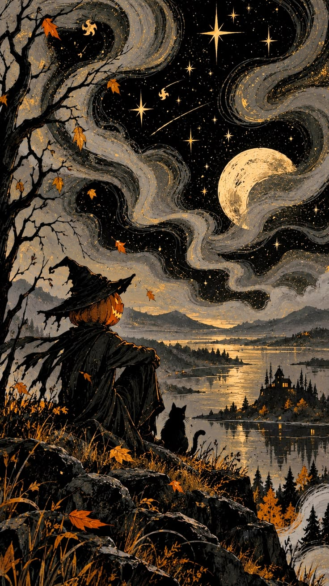
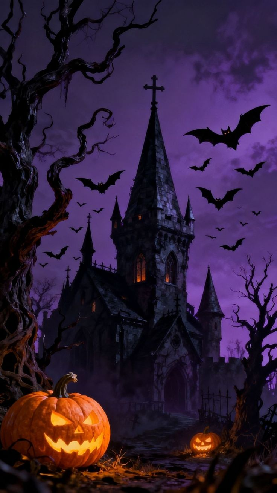
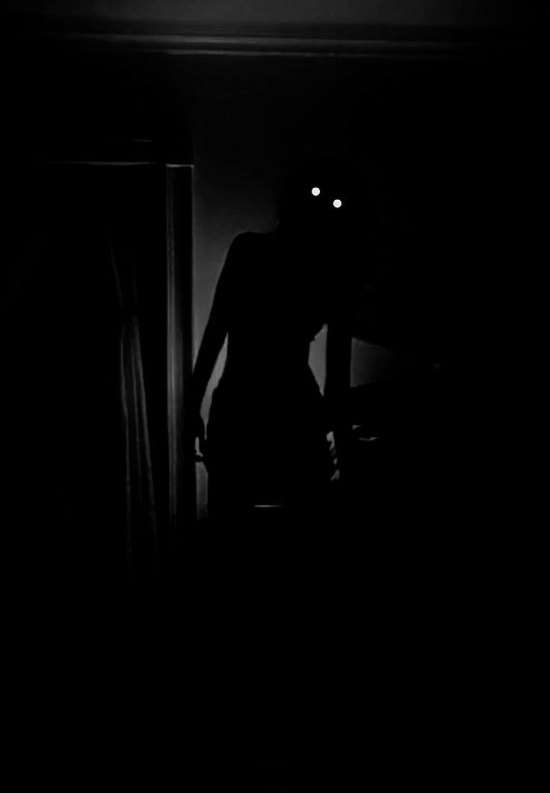

  

  

  

  
  
  

<table align="center">
  <tr>
    <td align="center">
      
    </td>
    <td align="center">
      
    </td>
  </tr>
</table>

<h1 align="center" style="font-size: 2.9em; color: #f4c95d; text-shadow: 2px 2px 0 #7a3b12; letter-spacing: 1px; font-family: Georgia, serif;">
  Welcome to the Queen Ghost Empire
</h1>

  This is the kingdom of pumpkins, moonlit silence, black roses, sweet tricks, and the beautiful thrill of October nights. Here, the air is cold, the stars are watchful, and the spirits celebrate in a quiet, charming glow.

  ◝(⁰▿⁰)◜  ✧  <b> Ghostly charm, candlelight, and enchanted October dreams...</b>

## The Moonlit Kingdom
The Queen Ghost loves the hush before midnight, the rustle of autumn leaves, the sparkle of haunted lights, and the kind of magic that turns an ordinary evening into a legend.

- 🌙 Moonlit magic and midnight charm
- 🖤 Velvet darkness wrapped in enchanting joy
- 🍬 Tricky treats, eerie laughs, and celebratory shadows
- 🌕 Under the moonlight, I will cast a spell.
- 🎃 RISE FROM THE SHADOWS, my creatures of the other side. 
- 🕸 We'll play a trick on those who dare not respect us. 
- ✨ It's Halloween, it's my time to let loose!
- ✦✧✦  <b>Happy Halloween, my little visitor. May your October be full of glow, magic, and little enchanted miracles. </b>  ✦✧✦

  

You stepped into my realm beneath the moon,

Now choose your fate—good luck or doom.

Give me your star, and I’ll bless your way,

Or leave it behind, and seven years of bad luck will stay.

Just a wish to share,
And a shining little star is all I ask you to spare.

  

  

